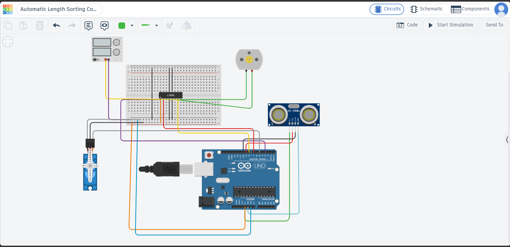
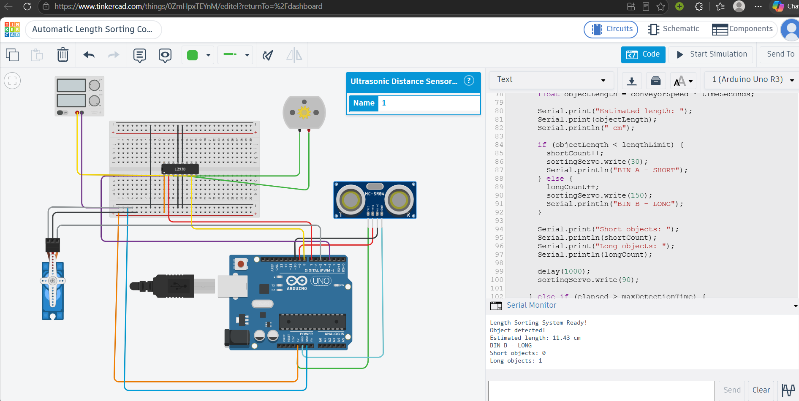

# Automatic Length Sorting Conveyor System

**ProDex IoT Task 1 – Factory-Based Product Inspection**

## 1. Project Overview

This project is an Arduino-based automatic object sorting system simulated in Tinkercad. It classifies objects according to their estimated length and directs them towards different bins using a servo motor.

The original task involved colour-based sorting. Since the TCS3200 colour sensor was unavailable in Tinkercad, a length-based sorting approach using an HC-SR04 ultrasonic sensor was implemented instead.

## 2. Components Used

- Arduino Uno
- HC-SR04 ultrasonic distance sensor
- L293D motor driver
- DC motor
- Micro servo motor
- External motor power supply
- Breadboard and connecting wires

## 3. Working Principle

1. The DC motor is driven through the L293D motor driver to represent the conveyor mechanism.
2. The ultrasonic sensor continuously measures the distance of objects in front of it.
3. When an object comes within 15 cm of the sensor, the Arduino records the detection time using `millis()`.
4. When the object moves out of the detection range, the Arduino calculates how long it was detected.
5. The object's estimated length is calculated using:

   **Estimated Length = Conveyor Speed × Detection Time**

6. A simulated conveyor speed of 5 cm/s is assumed for length estimation.
7. Objects shorter than 10 cm are classified into **Bin A**, and objects of length 10 cm or greater are classified into **Bin B**.
8. The servo rotates to 30° for Bin A and 150° for Bin B, then returns to its neutral position of 90°.
9. The Serial Monitor displays the estimated length, selected bin and total number of objects classified into each category.

**Simulation note:** Tinkercad does not physically simulate objects travelling on a conveyor belt in this circuit. Object movement is represented by manually changing the ultrasonic sensor's target distance. Therefore, the calculated length is an estimate based on the assumed conveyor speed, rather than a directly measured physical dimension.

## 4. Additional Features

- **Individual bin counters:** Tracks the number of short and long objects separately.
- **Detection timeout:** If an object remains detected for more than 10 seconds, the system displays a warning and does not count that detection.
- **Sensor timeout handling:** A missing ultrasonic echo is treated as an out-of-range measurement.
- **Automatic servo reset:** The sorting servo returns to 90° after classification.
- **Serial Monitor feedback:** Displays detection events, estimated lengths, sorting decisions and object counts.

## 5. Tinkercad Simulation

[View the Tinkercad Circuit](https://www.tinkercad.com/things/0ZmHpxTEYnM-automatic-length-sorting-conveyer-prodex)

## 6. Circuit and Output Evidence

### Circuit Diagram

### Simulation Output

The simulation output demonstrates successful detection and classification of a long object, with the estimated length and bin count displayed on the Serial Monitor.

## 7. Real-World Applications and Improvements

This system could be adapted for industrial applications such as sorting packages by size, separating manufactured components, and classifying products in packaging or assembly lines.

For a practical implementation, a physical conveyor belt and appropriate mechanical diverter would be required. An encoder could measure the actual belt speed instead of relying on an assumed value. Additional sensors could improve measurement accuracy, while calibration and object-spacing mechanisms could help handle objects of different shapes and multiple objects passing through the system.

## 8. Project Files

- `automatic_length_sorting_conveyer_prodex1.ino` – Arduino source code
- `Task1_Circuit.png` – Circuit screenshot
- `output.png` – Simulation output evidence
- `README.md` – Project documentation

## 9. Conclusion

The project demonstrates a simulated Arduino-based object classification and sorting system using ultrasonic sensing, motor control, servo actuation and timing-based length estimation. It provides a basic model that can be extended into a physical industrial sorting setup.
